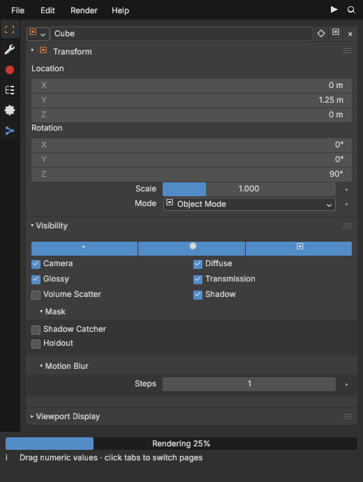
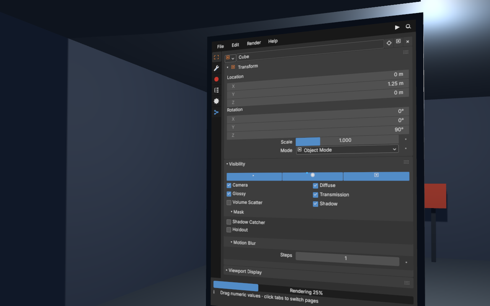
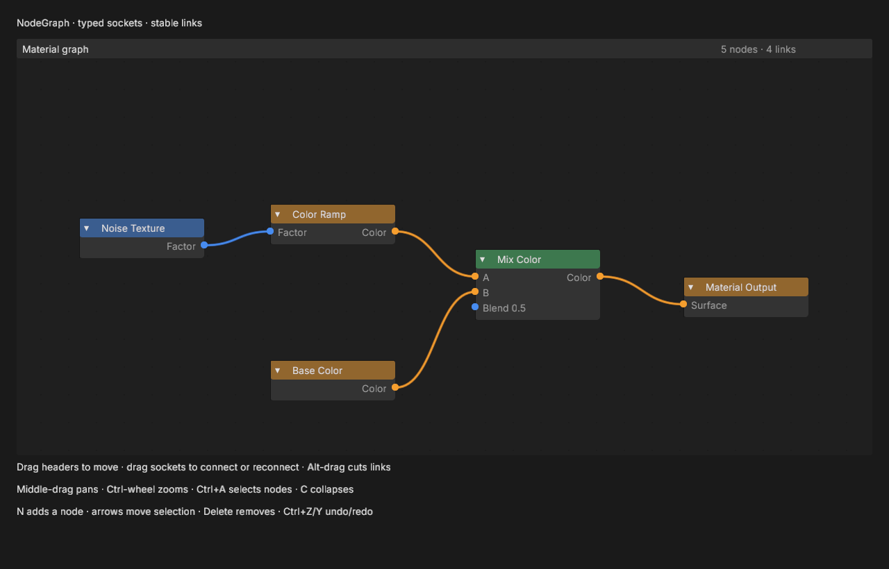
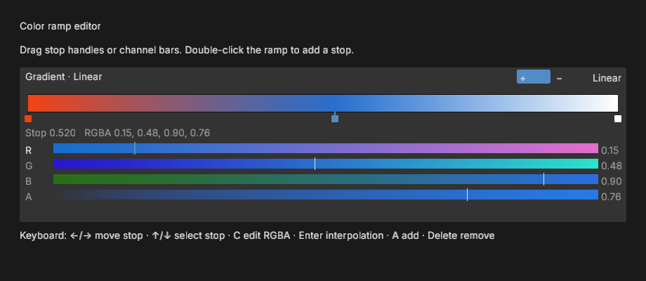
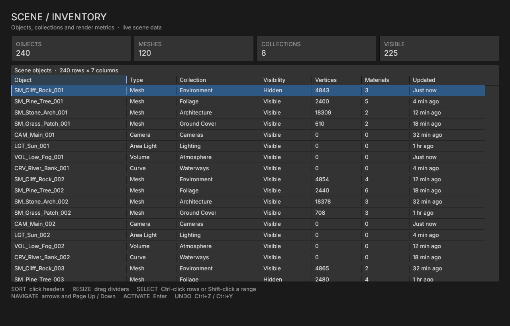
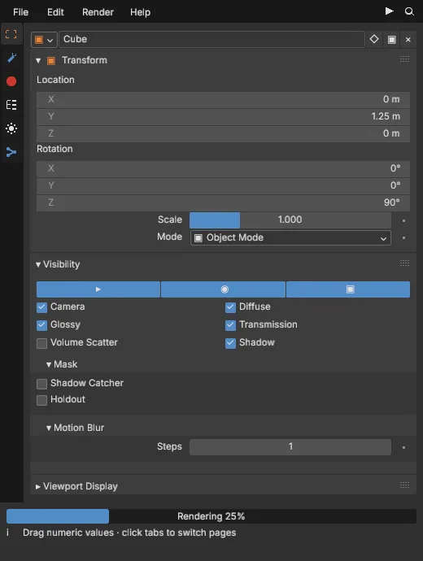
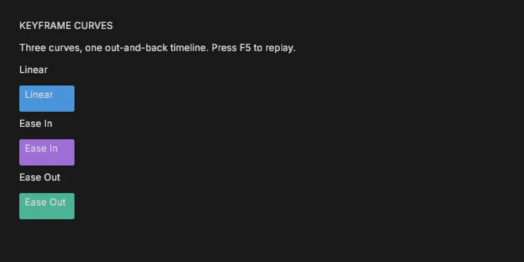
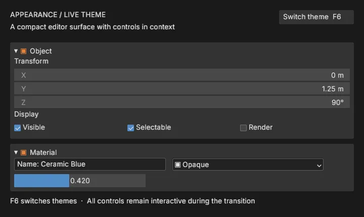

# BBUI

Blender-style UI for Bevy, written in Rust. Run it in a desktop window, a WebGPU browser, or on a mesh in a 3D scene.

| Properties editor | UI on a 3D mesh |
| --- | --- |
|  |  |

| Node editor | Color ramp | Data table |
| --- | --- | --- |
|  |  |  |

Panels, menus, fields, graphs, and tables are real widgets with pointer, keyboard, undo, and AccessKit support. The examples use the same public Rust API as an application.

| Panel collapse | Keyframe curves | Theme switch |
| --- | --- | --- |
|  |  |  |

[All example screenshots and animations](docs/visuals/README.md) · [Controls](docs/visuals/examples/controls.png) · [Menus](docs/visuals/examples/menus.png) · [Accessibility](docs/accessibility.md) · [Performance](docs/performance.md)

## Try it

Requires Rust 1.99 and Bevy 0.20.1. From this repository:

```sh
cargo run -p bbui --example properties_editor
cargo run -p bbui --example fps_world_ui
cargo run -p bbui --example theme_gallery
```

For your own app, start with [installing BBUI and mounting a widget tree](docs/getting-started.md). The [widget guide](docs/widgets.md) covers events and keyed updates; the [world-space guide](docs/world-space.md) covers the camera, texture, and mesh setup.
