# BBUI

Blender-style UI for Bevy, written in Rust. Run it in a desktop window, a WebGPU browser, or on a mesh in a 3D scene.

| Properties editor | UI on a 3D mesh |
| --- | --- |
| 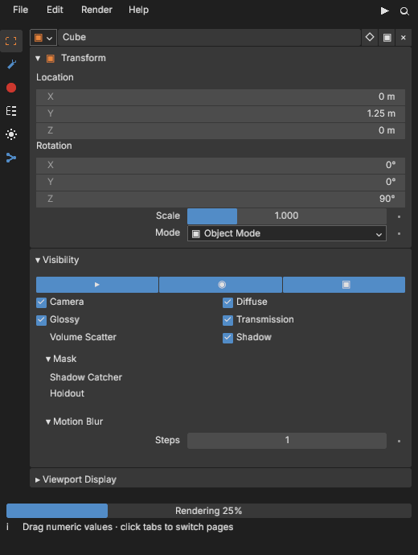 | 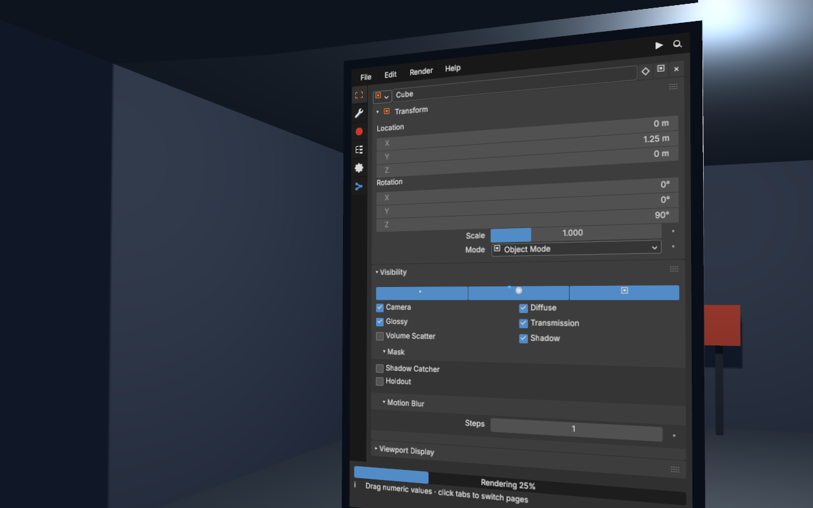 |

| Node editor | Color ramp | Data table |
| --- | --- | --- |
| 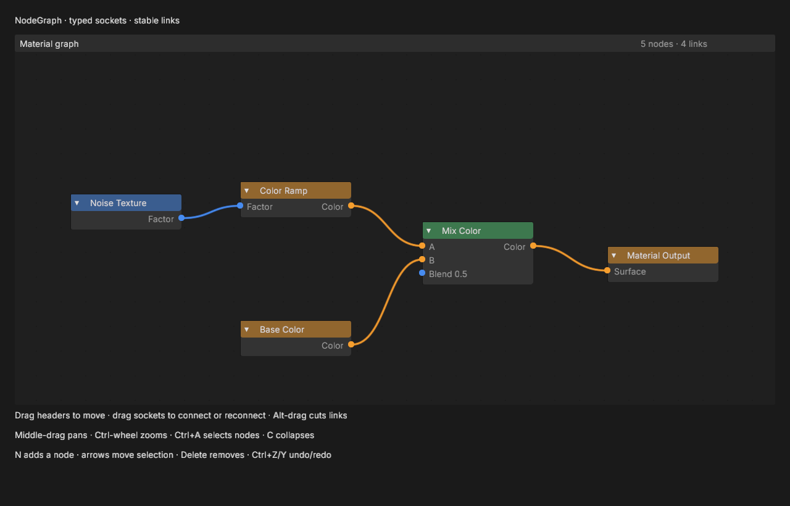 | 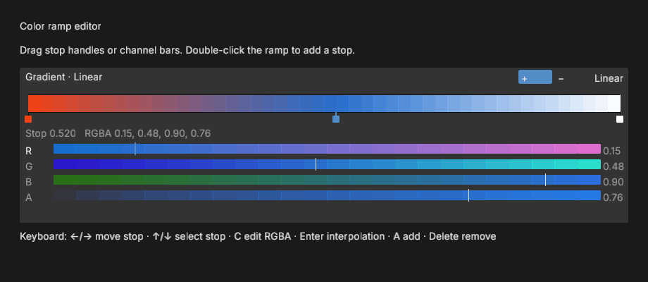 | 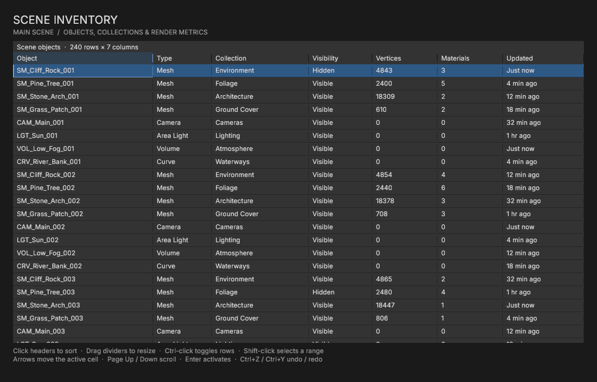 |

Panels, menus, fields, graphs, and tables are real widgets with pointer, keyboard, undo, and AccessKit support. The examples use the same public Rust API as an application.

| Panel collapse | Keyframe curves | Theme switch |
| --- | --- | --- |
| 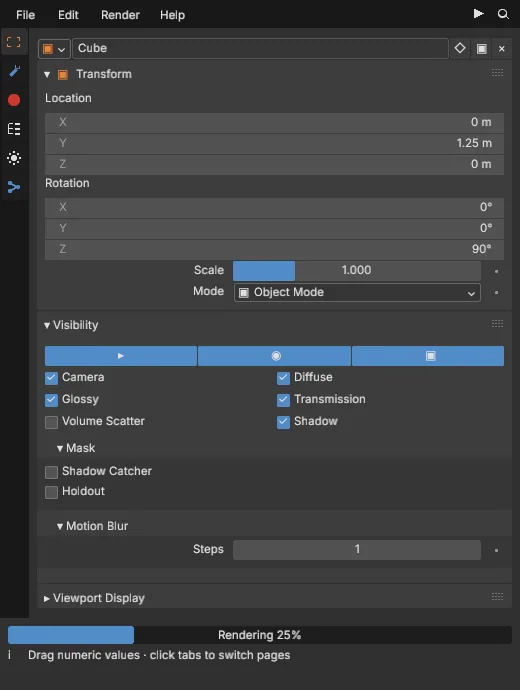 | 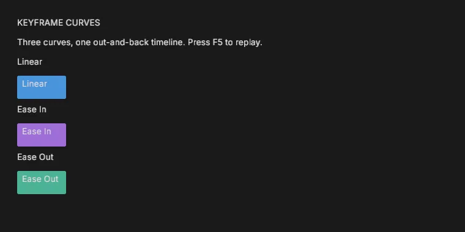 | 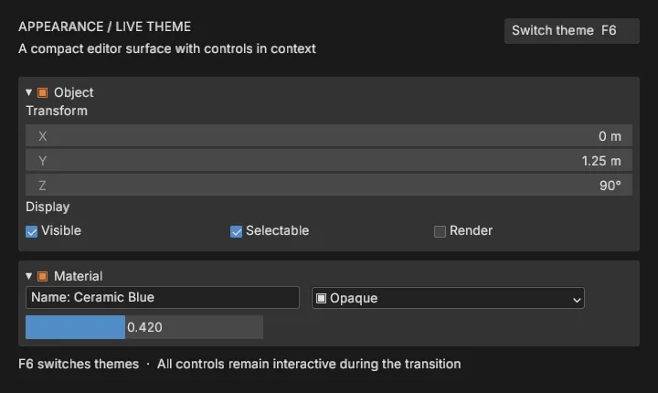 |

[All example screenshots and animations](docs/visuals/README.md) · [Controls](docs/visuals/examples/controls.png) · [Menus](docs/visuals/examples/menus.png) · [Accessibility](docs/accessibility.md) · [Performance](docs/performance.md)

## Dockable workspace

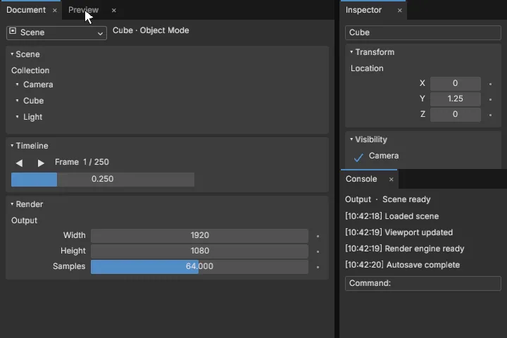

`Workspace` adds connected tabs, split and grid docking, tab reordering, keyboard docking, and undo/redo within one Bevy window. Stable pane IDs make layouts serializable; moving a pane keeps its mounted UI, and completed changes emit Bevy `WorkspaceEvent` messages. See the [splitter resize animation](docs/visuals/animations/workspace_resize.webp), [workspace guide](docs/workspace.md), and [light-theme capture](docs/visuals/examples/workspace-light.png).

## Visual effects

| Gradient border | Edge glow | Combined |
| --- | --- | --- |
| 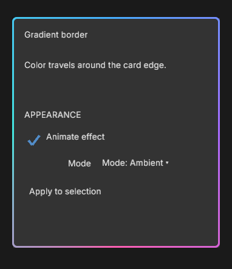 | 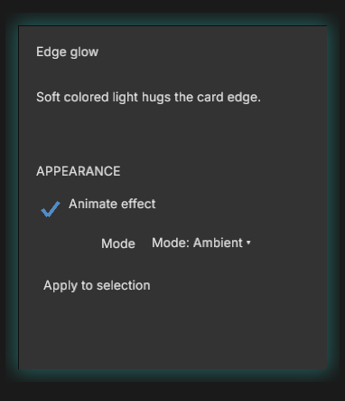 | 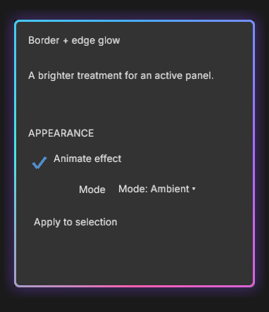 |

`UiVisualEffects` adds an optional border and edge glow to any widget node. Each can use one color or an evenly spaced palette, with fixed colors or theme tokens. They stay still unless a BBUI motion binding animates border or glow strength or palette phase; reduced motion follows the existing motion setting. These two-second preview loops show each moving effect at 60 fps. See the [full composition](docs/visuals/animations/visual-effects.webp), or run `cargo run -p bbui --example visual_effects` for the live window.

Use `UiBorderEffect::solid` or `UiBorderEffect::gradient` for a border, and `UiEdgeGlow::solid` or `UiEdgeGlow::gradient` for light around the silhouette. Attach either through `WidgetNode::with_visual_effects`.

**Border options**

| Solid static | Solid pulsing | Multicolor static | Multicolor rotating |
| --- | --- | --- | --- |
| 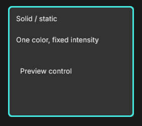 | 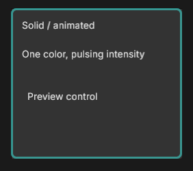 | 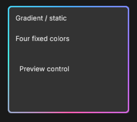 | 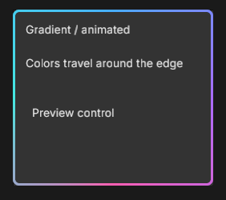 |

**Edge glow options**

| Solid static | Solid pulsing | Multicolor static | Multicolor rotating |
| --- | --- | --- | --- |
| 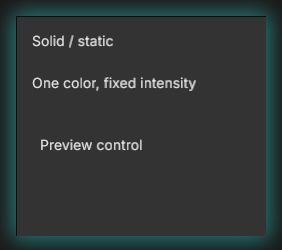 | 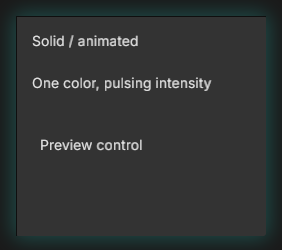 | 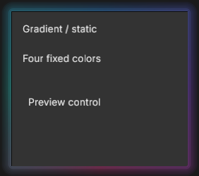 | 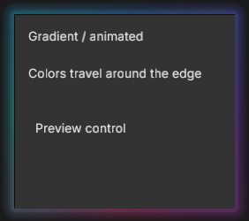 |

Run `BBUI_VISUAL_VARIANTS=1 cargo run -p bbui --example visual_effects` to compare all eight in one window.

## Progress bars

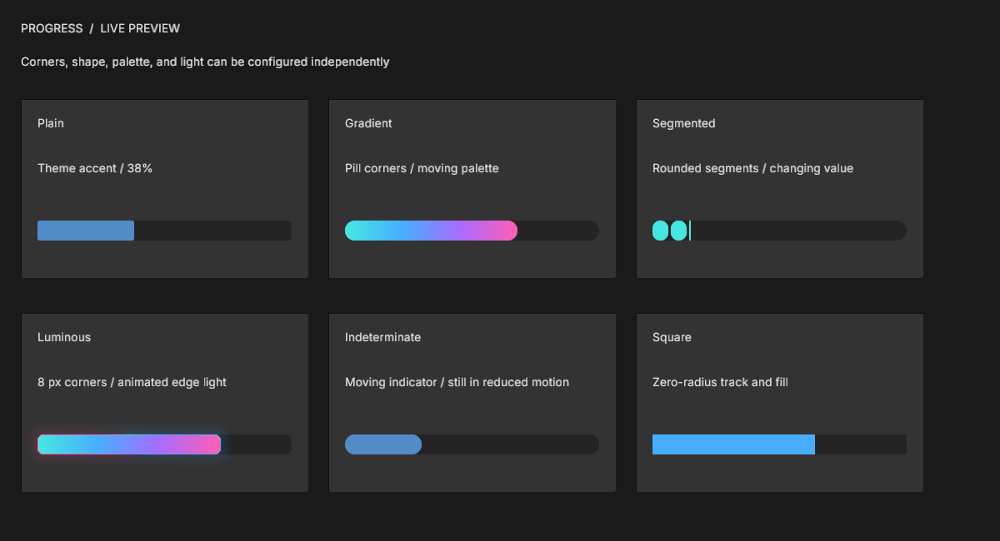

`Progress` supports continuous or segmented fills, theme colors or custom solid and gradient palettes, and optional border and edge glow on the filled portion. The glow follows the value instead of surrounding the whole track. Indeterminate bars sweep automatically and show a still indicator with reduced motion. Motion bindings can animate the displayed value, gradient palette, border and glow palette rotation, and border or glow strength; the preview clips capture 120 frames over two seconds at 60 fps.

```rust
let cyan = Rgba(0.27, 0.91, 0.88, 1.0);
let blue = Rgba(0.28, 0.68, 1.0, 1.0);
let violet = Rgba(0.66, 0.42, 1.0, 1.0);
let glow_color = Rgba(0.27, 0.91, 0.88, 0.22);
let style = ProgressStyle::gradient([cyan, blue, violet])
    .with_segments(12)
    .with_fill_glow(UiEdgeGlow::solid(glow_color, 10.0, 0.0));
let bar = WidgetNode::progress(0.64).with_progress_style(style);
let busy = WidgetNode::indeterminate_progress();
```

Compare the [gradient](docs/visuals/animations/progress-gradient.webp), [segmented](docs/visuals/animations/progress-segmented.webp), [glowing](docs/visuals/animations/progress-glow.webp), and [indeterminate](docs/visuals/animations/progress-indeterminate.webp) clips, or run `cargo run -p bbui --example progress_gallery`.

## Try it

Requires Rust 1.99 and Bevy 0.20.1. From this repository:

```sh
cargo run -p bbui --example properties_editor
cargo run -p bbui --example fps_world_ui
cargo run -p bbui --example theme_gallery
cargo run -p bbui --example workspace
cargo run -p bbui --example editor_workspace
cargo run -p bbui --example visual_effects
cargo run -p bbui --example progress_gallery
```

For your own app, start with [installing BBUI and mounting a widget tree](docs/getting-started.md). The [widget guide](docs/widgets.md) covers events and keyed updates; the [world-space guide](docs/world-space.md) covers the camera, texture, and mesh setup.
