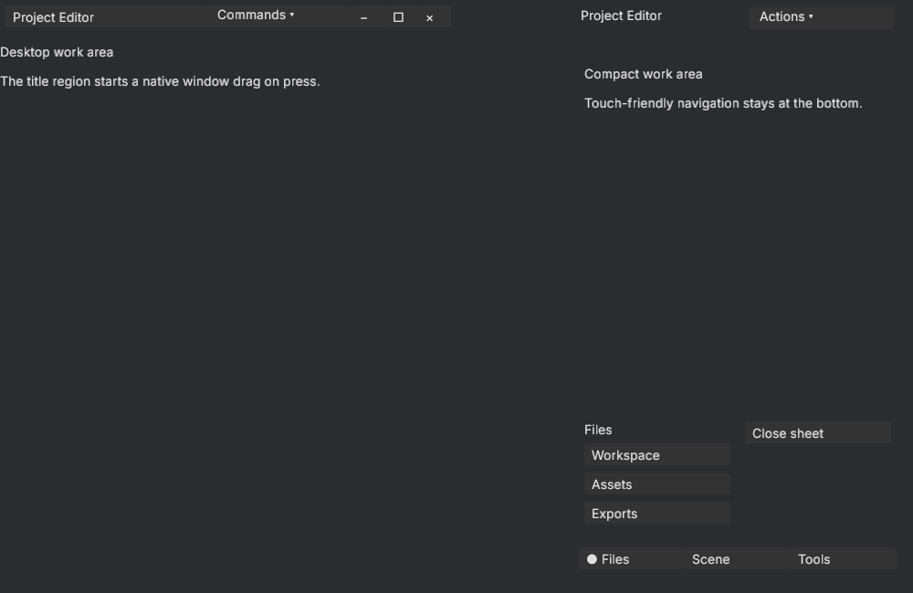
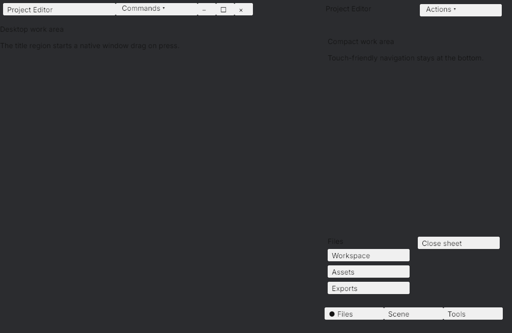

# Window chrome

`DesktopChrome` builds a BBUI title and command row. The host forwards a primary press to `handle_chrome_press` to start native window movement at the press edge. `chrome_action` translates control activations into close, minimize, and maximize requests. The host decides how to handle close requests, including unsaved work. On macOS, the row reserves space for native traffic lights.

`MobileChrome` builds a compact toolbar, content area, bottom navigation, and optional sheet from host-supplied content. Use `compact_chrome(window.resolution.width())` to switch at 600 logical pixels. Navigation returns stable IDs for the host to handle. The sheet is dismissible and remains within the shell layout.

| Dark theme | Light theme |
| --- | --- |
|  |  |

Run `cargo run -p bbui --example chrome_shell` for both layouts in one window. BBUI maps a primary touch to pointer events and ignores additional fingers until the active touch ends or is cancelled.

The library is checked for `aarch64-apple-ios` and `aarch64-linux-android` in CI. Embedding requires a host app to create a Bevy window and mount the chrome tree; BBUI does not package mobile app bundles. Device behavior still depends on the host's window integration.

Run `cargo bench -p bbui --bench performance --locked -- chrome` to measure reconciliation while opening and closing a mobile navigation sheet.
