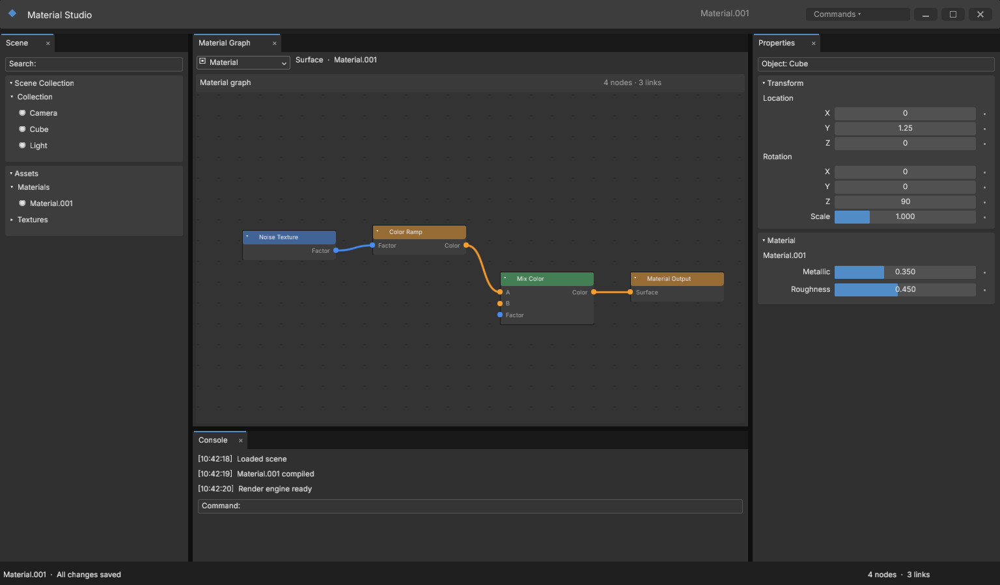
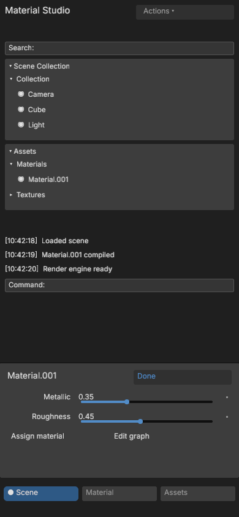
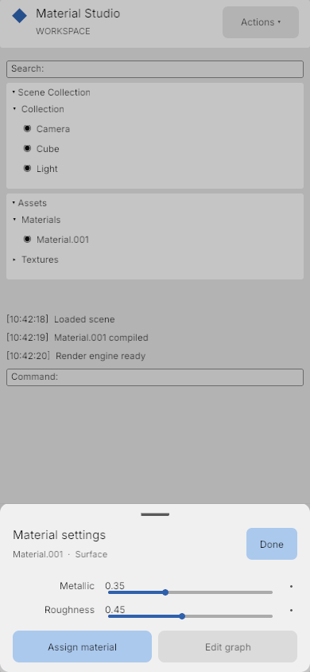
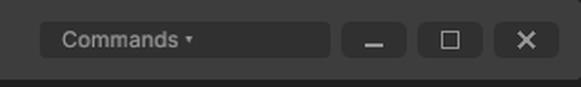

# Window chrome

`DesktopChrome` builds a BBUI title and command row. The host forwards a primary press to `handle_chrome_press` to start native window movement at the press edge. `chrome_action` translates control activations into close, minimize, and maximize requests. The host decides how to handle close requests, including unsaved work. On macOS, the row reserves space for native traffic lights.

`view_with` accepts `DesktopChromeAppearance` for titlebar height, padding, spacing, labels, control width, native button inset, control visibility, and themed styles for the surface, title, menu, and window controls. `view_with_slots` adds host content before or after the drag region. Controls retain stable keys for routing. Set `close_style` separately when the close action needs a distinct treatment.

The default minimize, maximize, and close marks are drawn as centered geometry inside equal-sized controls. Their size follows `control_style` / `close_style` font size. Replacing a control label in the appearance uses centered text instead, while its accessible name and action key remain stable.

`MobileChrome` builds a compact toolbar, content area, bottom navigation, and optional sheet from host-supplied content. Use `compact_chrome(window.resolution.width())` to switch at 600 logical pixels. Navigation returns stable IDs for the host to handle. The sheet is dismissible and remains within the shell layout.

`MobileChromeAppearance` controls toolbar and navigation height, sheet padding and spacing, copy, selected indicator, and separate theme-aware styles for each surface and control. Pass it to `view_with`. Use `compact_chrome_at(width, breakpoint)` for a host-selected breakpoint. The sheet's content remains a host-owned `WidgetNode`, so its controls and layout can be composed independently.

| Mode | Dark theme | Light theme |
| --- | --- | --- |
| Desktop editor |  |  |
| Compact editor |  |  |
| Desktop control hover | [Preview](visuals/examples/chrome-desktop-hover-dark.png) | [Preview](visuals/examples/chrome-desktop-hover-light.png) |
| Compact navigation hover | [Preview](visuals/examples/chrome-mobile-hover-dark.png) | [Preview](visuals/examples/chrome-mobile-hover-light.png) |
| Window controls, enlarged |  |  |

Run `cargo run -p bbui --example chrome_shell` for the desktop composition. The compact composition uses the same example at a 390-pixel window width. BBUI maps a primary touch to pointer events and ignores additional fingers until the active touch ends or is cancelled.

The library is checked for `aarch64-apple-ios` and `aarch64-linux-android` in CI. Embedding requires a host app to create a Bevy window and mount the chrome tree; BBUI does not package mobile app bundles. Device behavior still depends on the host's window integration.

Run `cargo bench -p bbui --bench performance --locked -- chrome` to measure reconciliation while opening and closing a mobile navigation sheet.
