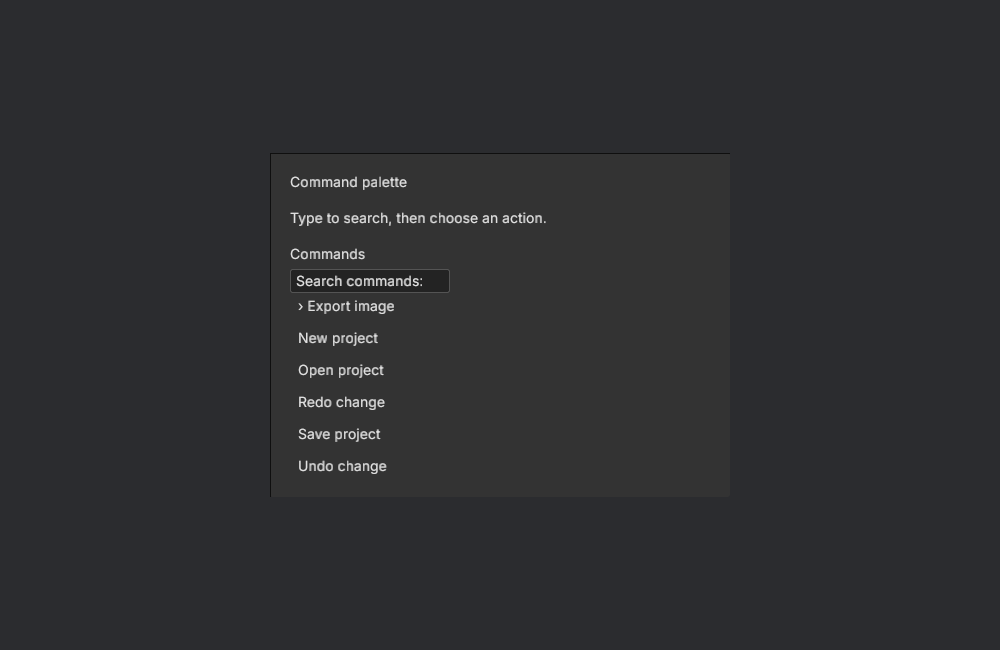

# Commands and palette

`CommandRegistry` holds application command IDs, labels, descriptions, categories, availability, and optional shortcuts. Registration rejects duplicate IDs and conflicting shortcuts. The host decides what an activated command does.

`CommandPalette` builds a BBUI widget tree from the registry. Mount its `view` inside an application overlay or shell, pass widget events to `handle_widget_event`, and reconcile the tree when the query changes. Forward unconsumed arrow, Enter, and Escape keys to `handle_key`. Both activation methods return a command ID. `CommandRegistry::menu_entries` supplies the same labels, availability, and shortcut hints to a BBUI menu.

| Dark | Light |
| --- | --- |
|  |  |

Run `cargo run -p bbui --example command_palette` to use the palette. The model has no platform menu ownership or user shortcut override storage.

For ranking and lookup measurements, run `cargo bench -p bbui --bench performance --locked -- commands`. The benchmark searches 32, 256, and 1,024 commands and measures shortcut resolution separately.
