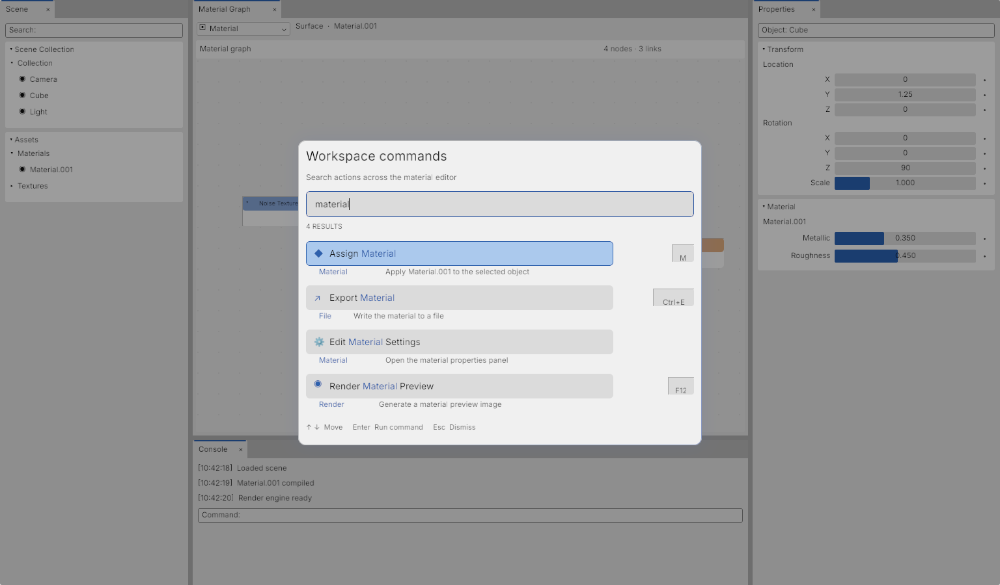

# Commands and palette

`CommandRegistry` holds stable IDs, labels, descriptions, categories, enabled state, optional glyphs, and shortcuts. Registration rejects duplicate IDs and conflicting shortcuts. The host decides what an activated command does.

`CommandPalette` builds a searchable BBUI surface from the registry. `show` opens it and clears the query and selection. Mount `view` or `view_with` in a host overlay, forward `WidgetEventQueue` events to `handle_widget_event`, and forward routed Arrow Up, Arrow Down, Enter, and Escape key presses to `handle_key`. Both activation methods return the command ID. Reconcile the view after the query, selection, or open state changes. `scroll_selected_into_view` keeps keyboard selection in the bounded results area. `visible_limit` bounds both rendered results and keyboard navigation.

Use `CommandPaletteSession::begin(world, window, root)` after mounting to focus the search field and confine Tab navigation to the overlay. Call `end` when the palette closes to restore the previous focus and input scope. The host owns the overlay lifecycle. The [example](../crates/bbui/examples/command_palette.rs) shows the complete event and focus wiring.

## Appearance and composition

`CommandPaletteAppearance` controls copy, width, maximum width and height, results height, padding, spacing, row height, text inset, shortcut column, icon width, text and surface styles, accent colors, and border/glow effects. Category and description have separate styles. Set `show_icons`, `show_shortcuts`, or `show_descriptions` to false for compact layouts. The host can calculate `width` from the window size; the example clamps it to the available width and simplifies the rows below 480 logical pixels. Long names are measured and ellipsized before they reach the shortcut column.

```rust
let mut appearance = CommandPaletteAppearance {
    title: "Find an action".into(),
    width: UiLength::Px((window_width - 32.0).min(680.0)),
    max_width: 680.0,
    max_results_height: 320.0,
    ..Default::default()
};
appearance.highlight_color = ThemeColorToken::Accent;
appearance.category_style.set_color_token(
    UiStyleProperty::Foreground,
    ThemeColorToken::MutedText,
);
let palette_node = palette.view_with(&registry, &appearance);
```

`view_with_slots` accepts custom header, empty state, footer, and result builders. A custom result must place `CommandPalette::action_key(id)` on the activating control; the search field keeps `CommandPalette::QUERY_KEY`. This lets the host replace section structure while keeping registry ranking and event handling. `CommandRegistry::menu_entries` supplies the same commands to BBUI menus.

## Gallery

| Dark | Light |
| --- | --- |
|  |  |

| State | Dark | Light |
| --- | --- | --- |
| Empty | [Preview](visuals/examples/command-palette-empty-dark.png) | [Preview](visuals/examples/command-palette-empty-light.png) |
| Long command | [Preview](visuals/examples/command-palette-long-dark.png) | [Preview](visuals/examples/command-palette-long-light.png) |
| Compact width | [Preview](visuals/examples/command-palette-compact-dark.png) | [Preview](visuals/examples/command-palette-compact-light.png) |
| Keyboard selection | [Preview](visuals/examples/command-palette-keyboard-dark.png) | [Preview](visuals/examples/command-palette-keyboard-light.png) |

Run `cargo run -p bbui --example command_palette` to use the palette over the docked editor. Run the ignored capture test to refresh gallery images. For ranking and lookup measurements, run `cargo bench -p bbui --bench performance --locked -- commands`.
