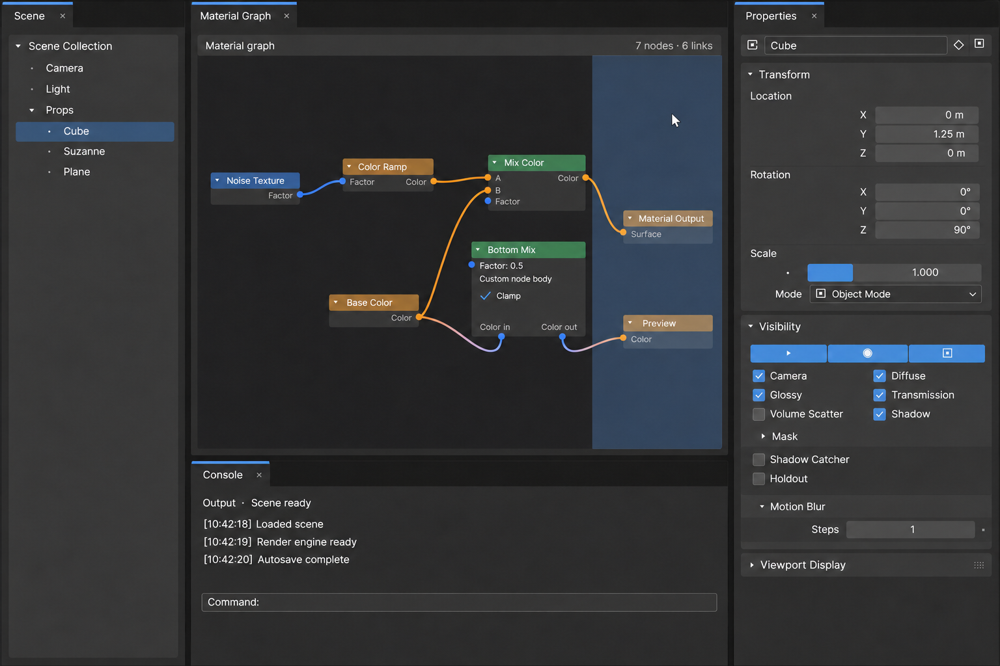

# Editor workspace composition proposal

**Status:** visual review. The images below are design mockups assembled from existing BBUI captures. They are not screenshots of a running example.

## Proposed default layout

Use one `WorkspaceLayout` in one Bevy window: a narrow Scene tree on the left, a large Material Graph in the center, Properties on the right, and Console below the graph. Each pane uses an existing BBUI widget family and the connected workspace tabs.

## Docking state

The translucent region shows the existing edge-drop preview while a tab is being dragged. The pane stays mounted when it moves.

## Scope after visual approval

- Build a runnable example using the public `Workspace`, `WidgetTree`, and `NodeGraph` APIs.
- Register pane builders for Scene, Material Graph, Properties, and Console. Use representative content from the current examples.
- Demonstrate layout save/restore and reading completed `WorkspaceEvent` Bevy messages in the example.
- Capture the running example in dark and light themes for the visual gallery.

This proposal does not change workspace behavior or add a new application service. The example implementation and renderer captures will follow visual approval.
