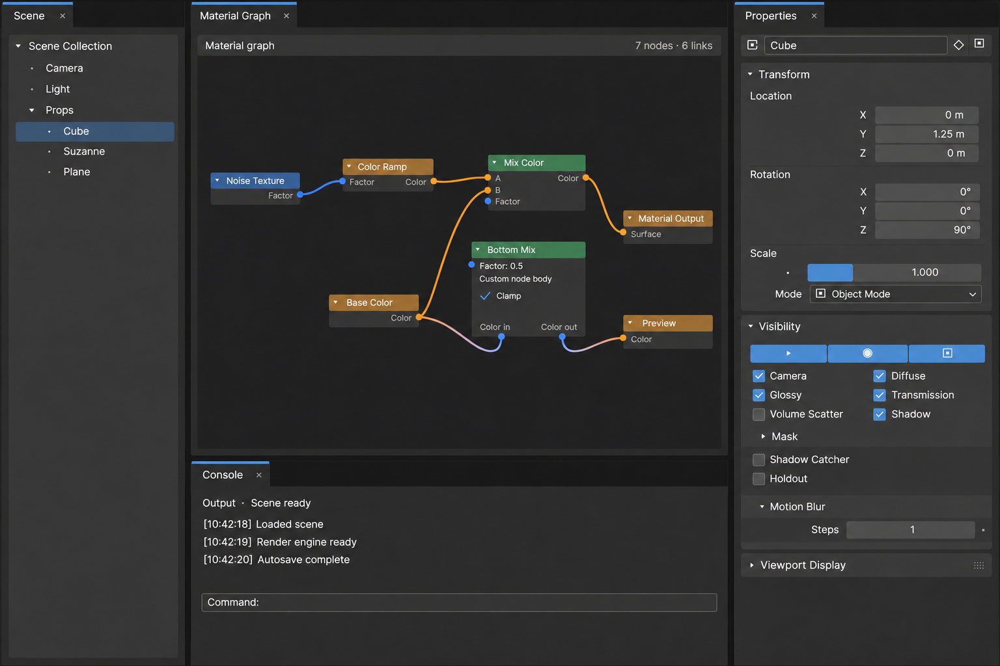

# Editor workspace composition proposal

**Status:** approved design, implemented in the [editor workspace example](../crates/bbui/examples/editor_workspace.rs). The images below remain design mockups assembled from existing BBUI captures; see the [dark](visuals/examples/editor-workspace-dark.png) and [light](visuals/examples/editor-workspace-light.png) captures for the actual renderer output.

## Proposed default layout

Use one `WorkspaceLayout` in one Bevy window: a narrow Scene tree on the left, a large Material Graph in the center, Properties on the right, and Console below the graph. Each pane uses an existing BBUI widget family and the connected workspace tabs.

## Docking state

The translucent region shows the existing edge-drop preview while a tab is being dragged. The pane stays mounted when it moves.

## Implemented example

- Run `cargo run -p bbui --example editor_workspace` to use the four panes. Drag tabs and splitters; F1–F4 reopen closed panes.
- F5 saves the layout to `target/editor-workspace-layout.json`; F9 restores it. The example reads completed `WorkspaceEvent` Bevy messages and logs them.
- The graph, Scene tree, Properties controls, and Console are mounted with public BBUI APIs. The actual renderer captures are in the visual gallery.

This example does not change workspace behavior or add an application service.
