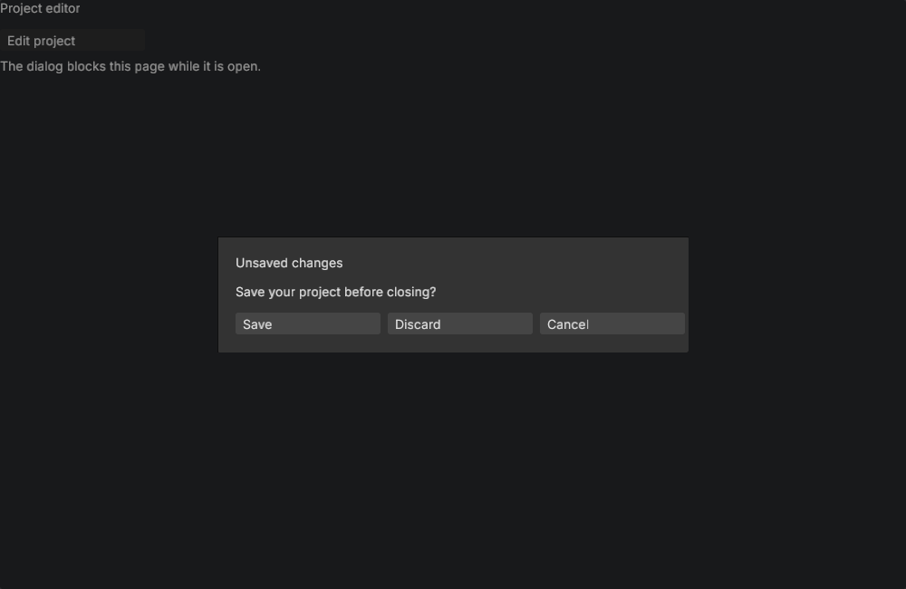
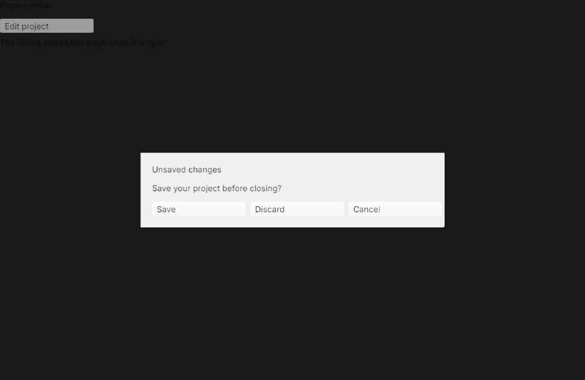

# Modal dialogs

`ModalDialog` composes a window-scoped confirmation from BBUI labels and buttons. While it is open, BBUI routes pointer, keyboard, and focus traversal only to that dialog's subtree. The backdrop blocks the rest of the BBUI window. The dialog is exposed to accessibility as a modal dialog, and the previous focus is restored on dismissal.

| Dark | Light |
| --- | --- |
|  |  |

```rust
ModalDialog::new(
    "Unsaved changes",
    "Save before closing?",
    vec![
        ModalAction::new("save", "Save"),
        ModalAction::new("discard", "Discard"),
        ModalAction::new("cancel", "Cancel"),
    ],
).show(world, window)?;
```

Read `ModalEvent` messages to handle `ModalDismissal::Action(id)` or `ModalDismissal::Escape`. Escape dismissal is enabled by default and can be disabled with `with_escape_dismissal(false)`. Call `dismiss_dialog(world, window)` to close a dialog from application code. A window accepts one active dialog; attempting to open another returns `ModalError::AlreadyOpen`. The host owns the action semantics, including save, discard, and close policy.

BBUI blocks its own controls behind the dialog. Applications with separate input systems, such as a 3D viewport, can read `ModalDialogs::is_open(window)` to suspend those interactions while the dialog is visible.

Run `cargo run -p bbui --example modal_dialog` for an interactive confirmation. After dismissing it, choose **Edit project** to reopen it.

## Performance measurements

Run `cargo bench -p bbui --bench performance --locked -- modal` to compare pointer and Tab routing with a modal scope open and closed over 10,000 controls. The open/close cases measure a confirmation and its accessibility refresh over pages with 100 and 1,000 controls. These are headless CPU measurements; they do not include GPU rendering.
