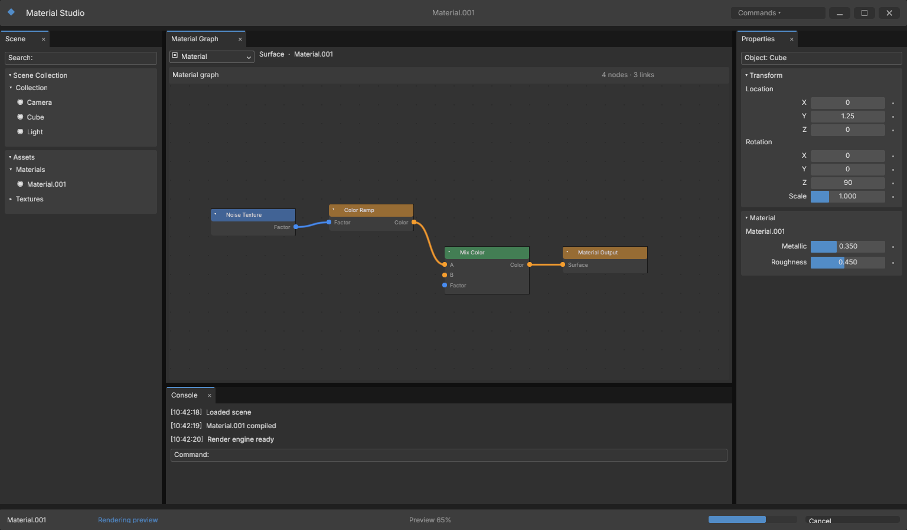

# Status bar

`StatusBar` is a compact surface with three equal-width widget sockets: `leading`, `center`, and `trailing`. The center socket is centered in the window, and the trailing socket is right-aligned. Each socket accepts any `WidgetNode`, including text, progress, controls, or an application-defined row. The bar owns no job state or actions; hosts handle events from their own widgets.

`StatusBarAppearance` controls the height, padding, region gap, and surface style. Supply only the regions you need. The host can put accessible live regions on changing content and can choose its own compact presentation by changing the supplied widgets.

```rust
let bar = StatusBar.view_with_slots(
    &StatusBarAppearance::default(),
    StatusBarSlots {
        leading: Some(WidgetNode::label("Ready")),
        center: Some(WidgetNode::label("Preview 65%")),
        trailing: Some(WidgetNode::progress(0.65)),
    },
);
```

The [example](../crates/bbui/examples/status_bar.rs) composes a status label, job progress, and a cancel button through these sockets. Run `cargo run -p bbui --example status_bar` to inspect it. Run `cargo test -p bbui --example status_bar --locked -- --ignored` to regenerate the captures, and `cargo bench -p bbui --bench performance --locked -- status/reconcile` to measure progress reconciliation.

| Dark | Light |
| --- | --- |
|  |  |

| State | Dark | Light |
| --- | --- | --- |
| Compact | [Preview](visuals/examples/status-bar-compact-dark.png) | [Preview](visuals/examples/status-bar-compact-light.png) |
| Action hover | [Preview](visuals/examples/status-bar-hover-dark.png) | [Preview](visuals/examples/status-bar-hover-light.png) |
