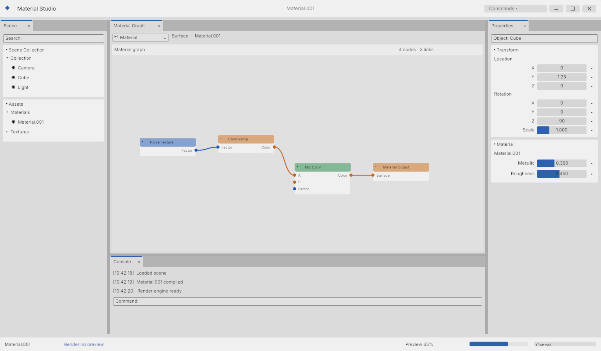

# Job status bar

`StatusBar` presents application-owned status items, progress, and an optional cancel control. It does not start jobs or change their state. `StatusProgress::normalized_fraction` clamps progress to 0–1 and treats invalid values as zero. `status_action` returns `CancelRequested` when the host activates the cancel button.

`StatusBarAppearance` controls height, padding, gap, progress width, copy visibility, and styles for each tone, progress label, cancel control, and bar surface. `StatusBarSlots` inserts host content before the status items or after the job controls. The bar marks changing status text and progress labels as accessible live regions.

```rust
let status = StatusBar {
    items: vec![
        StatusItem::new("Ready", StatusTone::Normal),
        StatusItem::new("Rendering preview", StatusTone::Accent),
    ],
    progress: Some(StatusProgress {
        label: "Preview 65%".into(),
        fraction: 0.65,
        cancel_label: Some("Cancel".into()),
    }),
};
let bar = status.view_with(&StatusBarAppearance::default());
```

Run `cargo run -p bbui --example status_bar` to inspect the standalone editor shell. Run `cargo test -p bbui --example status_bar --locked -- --ignored` to regenerate the captures, and `cargo bench -p bbui --bench performance --locked -- status/reconcile` to measure progress reconciliation.

| Dark | Light |
| --- | --- |
|  |  |

| State | Dark | Light |
| --- | --- | --- |
| Compact | [Preview](visuals/examples/status-bar-compact-dark.png) | [Preview](visuals/examples/status-bar-compact-light.png) |
| Cancel hover | [Preview](visuals/examples/status-bar-hover-dark.png) | [Preview](visuals/examples/status-bar-hover-light.png) |
