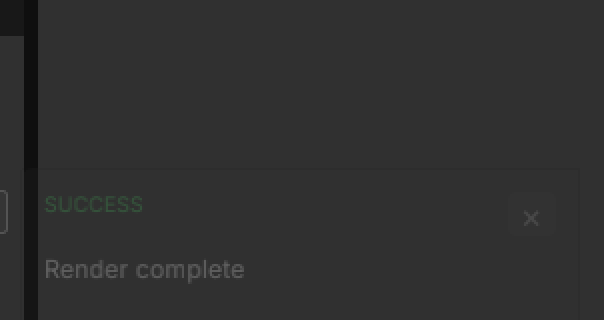
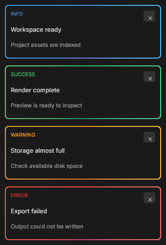
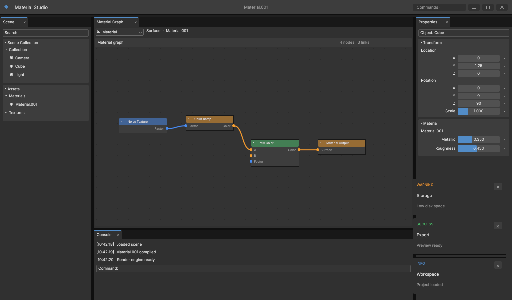
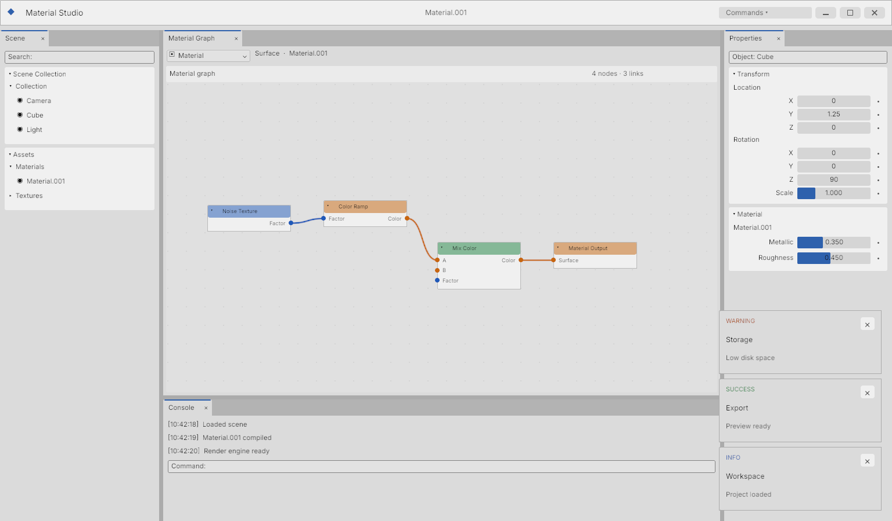

# Floating toasts

`ToastCenter` holds toasts per window. Post an `Info`, `Success`, `Warning`, or `Error` toast with a timed or persistent lifetime. The default view shows the newest three toasts; `set_visible_limit` changes that limit. Posting to a full window queue evicts its oldest toast after 32 stored entries. `ToastsPlugin` advances timed toasts with Bevy time and removes toasts when their window closes; hosts can also call `clear_window`. `generation()` tells hosts when to reconcile a mounted view. Dismiss buttons are handled with `handle_widget_event` and return the acknowledged toast.

Use `floating_view` to put the toast stack over application content. It defaults to the lower-right corner and only covers the card area; it does not reserve space in the workspace or dim the content. `ToastOverlayAppearance` exposes the corner, width, and four edge margins in logical pixels. All four corners are supported. When no toasts are visible, the floating stack paints nothing. If content has children mounted outside the declarative tree, reconcile `floating_stack` into the existing `toast:center` node when `generation()` changes. These floating view methods take `&mut ToastCenter` so the first mounted render can start each entry transition reliably. The plain `view` and `view_with_slots` methods remain available for hosts that deliberately want an activity feed.

Floating cards use `UiAutoAnimations` and BBUI's motion player to fade and translate 18 logical pixels into place over 280 ms. The entire card stays within the workspace while moving, so its border remains intact. Dismissed or expired cards fade and move out over 220 ms before leaving the mounted stack. `ToastCenter::set_motion` changes those durations, travel distance, and separate opacity and travel curves for entry and exit. The defaults remain `EaseOut` on entry and `EaseIn` on exit. Any `MotionCurve`, including a validated cubic Bézier, can be used for each property. Theme `motion_scale` adjusts clip duration, and `UiReducedMotion` snaps both phases immediately. The queue advances through `ToastsPlugin`; a host that drives `ToastCenter` directly calls `advance` with elapsed time and reconciles when `generation()` changes.

```rust
let travel_curve = MotionCurve::cubic_bezier(0.16, 0.95, 0.3, 1.0)
    .expect("valid cubic Bézier");
center.set_motion(ToastMotion {
    enter: Duration::from_millis(280),
    exit: Duration::from_millis(220),
    travel: 18.0,
    enter_opacity_curve: MotionCurve::EaseOut,
    enter_travel_curve: travel_curve,
    exit_opacity_curve: MotionCurve::EaseInOut,
    exit_travel_curve: MotionCurve::EaseIn,
});
```



Run `python3 scripts/capture_toast_animations.py` to regenerate this preview from offscreen renderer frames sampled at 60 fps.

`view_with` accepts `ToastAppearance`: card and stack spacing, padding, dismiss copy and dimensions, empty-state copy, per-severity text styles, surface styles, and optional visual effects for each severity. Increase `dismiss_width` when replacing the default × with a word such as “Close.” Cards use theme-aware success, warning, and error colors with a neutral border by default; set `severity_borders` to color the outline by severity. Set `info_effects`, `success_effects`, `warning_effects`, or `error_effects` to attach a `UiVisualEffects` border or glow to the standard card. `message_wrap_columns` and `message_max_lines` bound long messages in narrow panels; the complete message remains in the toast data and the label's accessible name. `view_with_slots` accepts host header, empty state, footer, and custom toast renderer nodes. The default renderer keeps stable dismiss keys and assertive live regions for warnings and errors.

The [gradient toast example](../crates/bbui/examples/toast_gradient_borders.rs) gives Info, Success, Warning, and Error separate rotating border palettes. It uses the existing `UiBorderEffect`, `border_phase_binding`, and `MotionPlayer`, so hosts can change each palette, width, radius, strength, and rotation speed. Its `BORDER_MOTION` configuration exposes the cycle duration and `MotionCurve`; linear is the default for an uninterrupted rotation. The example starts clips only for cards in its own toast stack, preserves their live border phase during reconciliation, and settles them under reduced motion. Run `cargo run -p bbui --example toast_gradient_borders` to inspect it live, or `python3 scripts/capture_toast_gradient_borders.py` to regenerate this 60 fps preview.



[Full-size still](visuals/examples/toast-gradient-borders-dark.png)

```rust
let appearance = ToastAppearance {
    message_wrap_columns: 28,
    message_max_lines: 3,
    ..Default::default()
};
let workspace = WidgetNode::column([]).with_width(UiLength::Fill(1.0));
let floating = center.floating_view(
    window,
    workspace,
    &appearance,
    &ToastOverlayAppearance::default(),
);
```

| Dark | Light |
| --- | --- |
|  |  |

| State | Dark | Light |
| --- | --- | --- |
| Long error message | [Preview](visuals/examples/toasts-long-dark.png) | [Preview](visuals/examples/toasts-long-light.png) |
| Empty activity | [Preview](visuals/examples/toasts-empty-dark.png) | [Preview](visuals/examples/toasts-empty-light.png) |
| Dismiss hover | [Preview](visuals/examples/toasts-hover-dark.png) | [Preview](visuals/examples/toasts-hover-light.png) |
| Text dismiss button | [Preview](visuals/examples/toasts-dismiss-copy-dark.png) | [Preview](visuals/examples/toasts-dismiss-copy-light.png) |
| Entering toast | [Preview](visuals/examples/toasts-enter-dark.png) | [Preview](visuals/examples/toasts-enter-light.png) |
| Exiting toast | [Preview](visuals/examples/toasts-exit-dark.png) | [Preview](visuals/examples/toasts-exit-light.png) |

Run `cargo run -p bbui --example toasts` for a docked material editor with floating toasts and dismiss controls. Run `cargo bench -p bbui --bench performance --locked -- toasts` to measure bounded toast lookup.
