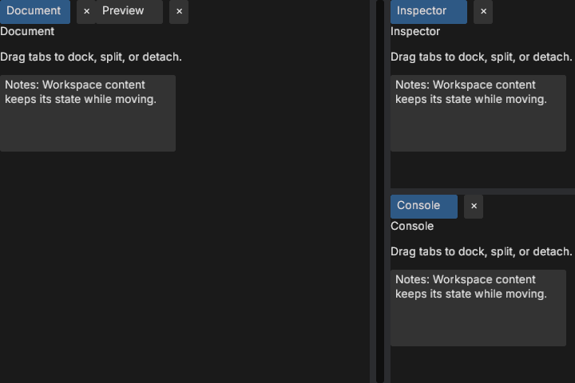
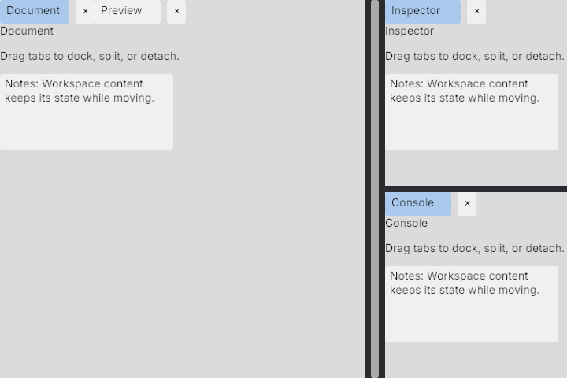
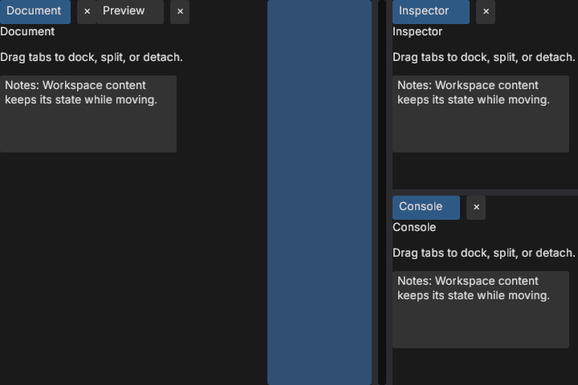

# Workspace

`Workspace` is BBUI's dockable pane control. A `PaneId` identifies one live pane instance. A `TabGroup` holds panes, and `Split` and `Grid` arrange groups. `WorkspaceLayout` stores the arrangement without Bevy entity IDs, so applications can serialize it.

| Dark | Light | Edge drop preview |
| --- | --- | --- |
|  |  |  |

Run `cargo run -p bbui --example workspace` to use the control in a native Bevy window. The example uses F1–F4 to reopen closed panes.

## Create panes

Build a `WorkspaceLayout`, register each pane's title and UI builder, then insert `Workspace` as a resource. The builder receives a parent BBUI entity and mounts the pane UI under it. The [workspace example](../crates/bbui/examples/workspace.rs) shows a complete setup with tabs, a split, and a grid.

```rust
let layout = WorkspaceLayout::new(DockNode::Tabs(TabGroup::new(
    "editors",
    vec![PaneId::from("scene")],
)));
let mut workspace = Workspace::new(layout)?;
workspace.register_pane("scene", "Scene", |world, parent| {
    let tree = WidgetTree::new(WidgetNode::label("Scene editor"));
    let _ = tree.spawn(world, Some(parent));
});
world.insert_resource(workspace);
```

The host owns document data. Moving a pane keeps its mounted entity and transient widget state. Closing it unmounts the UI; `WorkspaceOperation::Open` rebuilds it from host state. A saved layout that refers to an unregistered pane shows a placeholder until that pane is registered.

## Docking and windows

- Drag a tab onto a group's center to join it, or over another tab to choose its insertion point. Drop on a group edge to create a split. Hold Shift over the center to create a grid.
- Release a dragged tab outside the groups to create a native Bevy window. A pane can move between existing windows. Closing a detached window closes its panes; those panes can be reopened normally.
- Drag a splitter or focus it and use the arrow keys to resize. Tabs support arrow-key selection, Enter/Space activation, and Delete to close. Ctrl+Z/Y on workspace chrome undo or redo layout edits.
- `TabGroupOptions` independently control tab reordering, movement out of a group, acceptance of drops, and native-window detaching. A single pane shows its tab by default; hiding that bar leaves a small drag handle.

All edits use `WorkspaceOperation` and the same validation path, including programmatic edits. `Workspace::set_close_guard` can reject an explicit close request. `Workspace::appearance` and `set_appearance` configure theme tokens and chrome dimensions. Workspace chrome also has roles such as `workspace-tab`, `workspace-tab-bar`, and `workspace-tab-group` for styling and accessibility.

Serialize `workspace.layout()` with Serde to persist the arrangement. Use `Workspace::restore` for a saved `WorkspaceLayout`; it validates the version and IDs before replacing the live layout.
