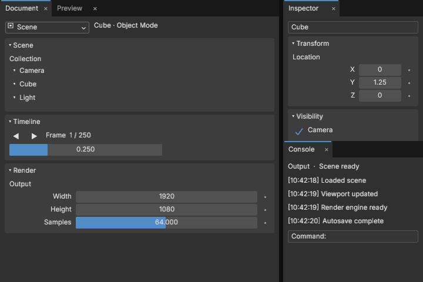
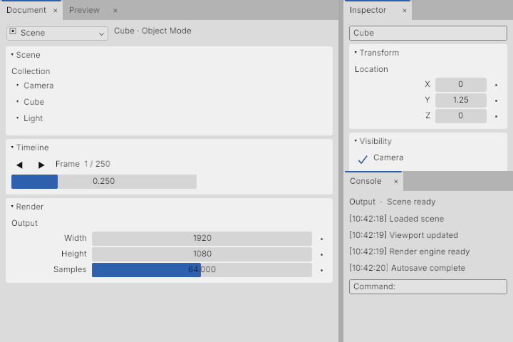
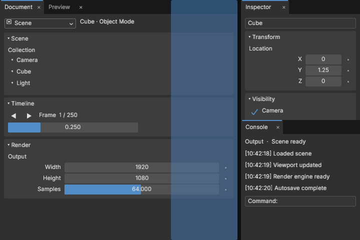
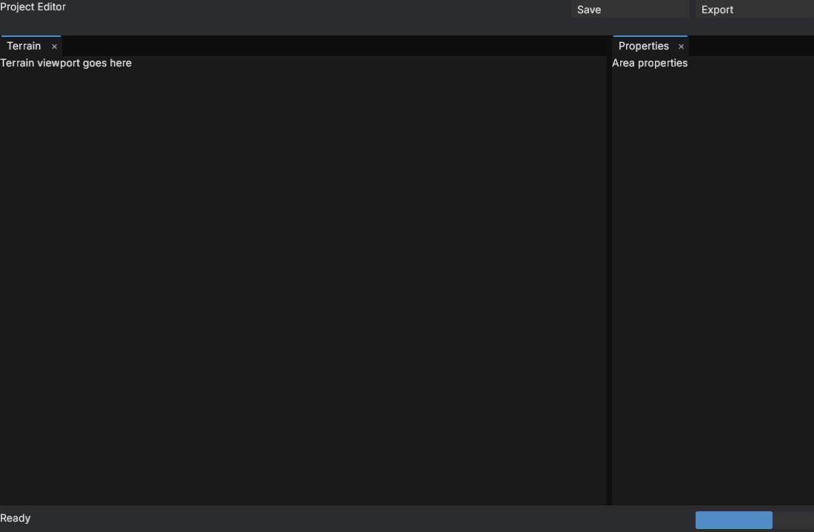
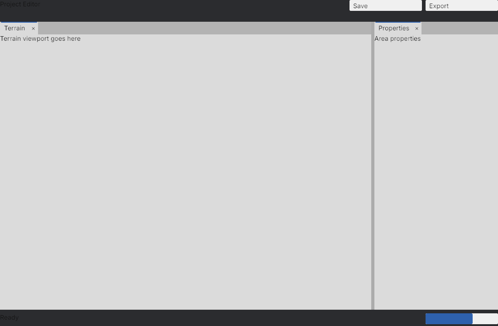

# Workspace

`Workspace` is BBUI's dockable pane control for one Bevy window. A `PaneId` identifies one live pane instance. A `TabGroup` holds panes, and `Split` and `Grid` arrange groups. `WorkspaceLayout` stores one root tree without Bevy entity IDs, so applications can serialize it.

| Dark | Light | Edge drop preview |
| --- | --- | --- |
|  |  |  |

[Watch a tab dock into a split](visuals/animations/workspace_dock.webp) or [drag the splitter](visuals/animations/workspace_resize.webp). Both clips use 60 Hz samples from the actual offscreen Bevy renderer.

Run `cargo run -p bbui --example workspace` to use the control in a native Bevy window. The example uses F1–F4 to reopen closed panes.

For a composed editor, run `cargo run -p bbui --example editor_workspace`. It places a real node graph beside Scene and Properties panes, with a Console below the graph. F1–F4 reopen panes, F5 saves the layout, and F9 restores it. The [dark](visuals/examples/editor-workspace-dark.png) and [light](visuals/examples/editor-workspace-light.png) captures show the running example.

## Create panes

Build a `WorkspaceLayout`, register each pane's title and UI builder, then insert `Workspace` as a resource. The builder receives a parent BBUI entity and mounts the pane UI under it. The [workspace example](../crates/bbui/examples/workspace.rs) shows a complete setup with tabs, a split, and a grid.

```rust
let layout = WorkspaceLayout::new(DockNode::Tabs(TabGroup::new(
    "editors",
    vec![PaneId::from("scene")],
)));
let mut workspace = Workspace::new(layout)?;
workspace.register_pane("scene", "Scene", |world, parent| {
    let tree = WidgetTree::new(WidgetNode::label("Scene editor"));
    let _ = tree.spawn(world, Some(parent));
});
world.insert_resource(workspace);
```

The host owns document data. Moving a pane keeps its mounted entity and transient widget state. Closing it unmounts the UI; `WorkspaceOperation::Open` rebuilds it from host state. A saved layout that refers to an unregistered pane shows a placeholder until that pane is registered.

## Place a workspace inside an application shell

Call `workspace.set_mount_parent(parent)` with a BBUI node inside the window's layout tree before inserting the resource. The workspace fills that node and follows its size when the shell or window changes. Its tabs, splitters, and drop targets use the resulting bounds. `clear_mount_parent()` restores the default full-window mounting mode. The [workspace shell example](../crates/bbui/examples/workspace_shell.rs) puts a command row above the dock and a status strip below it.

| Dark shell | Light shell |
| --- | --- |
|  |  |

```rust
let mut workspace = Workspace::new(layout)?;
workspace.set_mount_parent(center_region);
world.insert_resource(workspace);
```

## Docking

- Drag a tab onto a group's center to join it, or over another tab to choose its insertion point. Drop on a group edge to create a split. Hold Shift over the center to create a grid.
- Dragging a tab between groups moves it while preserving its mounted UI. Leaving the native window cancels the drag.
- Drag a splitter or focus it and use the arrow keys to resize. Tabs support arrow-key selection, Enter/Space activation, and Delete to close. Focus a tab and press Ctrl+Space to move it with the keyboard; arrows cycle docking targets, Enter commits, and Escape cancels. Ctrl+Z/Y on workspace chrome undo or redo layout edits.
- `TabGroupOptions` independently control tab reordering, movement out of a group, and acceptance of drops. A single pane shows its tab by default; hiding that bar leaves a small drag handle.

All edits use `WorkspaceOperation` and the same validation path, including programmatic edits. `Workspace::set_close_guard` can reject an explicit close request. `Workspace::appearance` and `set_appearance` configure theme tokens and chrome dimensions. Workspace chrome also has roles such as `workspace-tab`, `workspace-tab-bar`, and `workspace-tab-group` for styling and accessibility.

The default active tab shares its pane's background and has a slim accent along its top edge. Inactive tabs sit on the darker tab rail. `WorkspaceAppearance` exposes the active, inactive, and pane background tokens for other themes.

After a successful layout change, BBUI emits a Bevy `WorkspaceEvent` message. Read it with `MessageReader<WorkspaceEvent>` in an application system. Its variants report tab selection, pane opening and closing, reordering, moving, docking, grid placement, split resizing, group option changes, and layout restoration. Applications can react to these completed changes and read `workspace.layout()` for the current arrangement. Cancelled, rejected, and unchanged edits emit no change event.

Serialize `workspace.layout()` with Serde to persist the arrangement. Use `Workspace::restore` for a saved `WorkspaceLayout`; it validates the version and IDs before replacing the live layout.

## Performance measurements

Run `cargo bench -p bbui --bench performance --locked -- workspace` to measure workspace layout operations and headless Bevy updates. The cases cover idle frames, tab selection, pane moves, committed splitter resizing, pointer-driven splitter dragging, and chrome refresh at 2, 8, and 32 groups with three panes each. These are CPU measurements; they do not include GPU rendering or application pane content.

During a pointer-driven splitter preview, BBUI updates the two adjacent split shares in place and keeps pane entities mounted. The drag benchmark verifies that the rendered group width actually changes, so it cannot report a speedup from updating only the saved layout.
